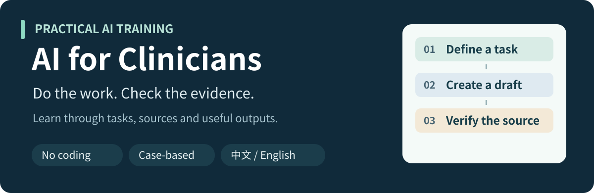

[简体中文](README.md) · [English](README.en.md)

# AI for Clinicians

Practical AI training for clinicians with no programming background.

Start with a real task, learn how to ask useful questions, organize material and check the output, then leave with something you can reuse at work.

## Choose your starting point

| What would you like to do? | Start here | What you will produce |
| --- | --- | --- |
| Take a lesson yourself | [Lesson 02: From a Clinical Question to Evidence](lessons/02-evidence/README.en.md) | An evidence table, error corrections and a short conclusion |
| Check the materials first | [Five-minute quick start](START_HERE.en.md) | A preparation checklist and an approximately 55-minute learning route |
| Run a departmental workshop | [Instructor guide](lessons/02-evidence/instructor.en.md) | A teaching schedule, answer key and pilot feedback method |

## This lesson's task: Can AI help physicians with diagnostic reasoning?

Three real studies illustrate comparisons that need to be kept distinct. Complete one guided evidence row, find the errors, then produce your own evidence-based summary.

- [Read the materials](lessons/02-evidence/sources.en.md): study cards, original papers and exact reading locations.
- [Try the exercises](lessons/02-evidence/practice.en.md): correct six errors and complete an independent assignment.
- [Review your work](lessons/02-evidence/answer-key.en.md): compare your reasoning with examples and a 20-point rubric.

No coding or particular paid AI service is required. If you do not have an AI account, the supplied materials still let you practise checking evidence.

## Six-lesson route

| Lesson | Status | Your output |
| --- | --- | --- |
| 01 · Getting Useful Work from AI | Planned | A reusable task template |
| [02 · From a Clinical Question to Evidence](lessons/02-evidence/README.en.md) | Ready to study | An evidence table, error corrections and a short conclusion |
| 03 · Research Tables and Charts | Planned | An organized table and traceable chart notes |
| 04 · Turning an Idea into a Discussable Study | Planned | A one-page research plan and collaboration brief |
| 05 · Papers, Presentations and Teaching Materials | Planned | A draft you can develop further |
| 06 · A Clinician's Role in a Medical AI Project | Planned | A collaboration and paper-appraisal checklist |

[Explore the course outline](course/README.en.md)

## Download the worksheets

[Task brief](templates/task-card.en.md) · [Evidence table CSV](templates/evidence-table.en.csv) · [Search log CSV](templates/search-log.en.csv) · [Evidence checklist](templates/evidence-checklist.en.md) · [Worked evidence row](examples/p1-worked.en.csv)

Use Raw / Download raw file on a GitHub file page to download CSVs, then open them in Excel or another spreadsheet application. Chinese and English worksheets are provided separately and match their respective lessons.

## Help us improve the course

Try the lesson yourself or in a small departmental workshop. Record confusing steps, inaccessible sources and unclear wording, and share reproducible feedback through this repository's Issues. The [instructor guide](lessons/02-evidence/instructor.en.md#feedback) provides a recording method.

Only the Lesson 02 sample is currently complete; learning outcomes have not yet been evaluated with clinicians. The three studies are fixed teaching selections, and the exercises use public literature and course-authored material. No patient records are needed.
