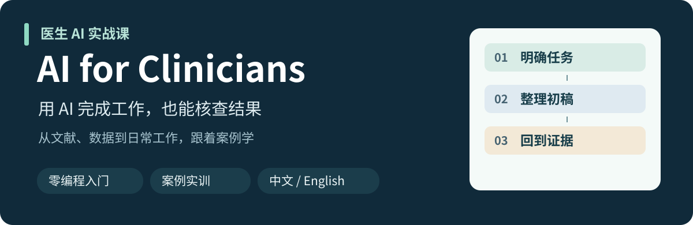

[简体中文](README.md) · [English](README.en.md)

# 医生 AI 实战课

给没有编程基础的临床医生，一套跟着案例就能开始的 AI 工作与科研训练。

从一个具体任务出发，学会提问、整理材料、核查结果，最后带走可复用的工作成果。

## 从这里开始

| 你现在想做什么 | 入口 | 你会得到什么 |
| --- | --- | --- |
| 自己学一节课 | [开始第 2 课：从临床问题到文献证据](lessons/02-evidence/README.md) | 证据表、纠错说明和一段研究结论 |
| 先看看要准备什么 | [5 分钟快速开始](START_HERE.md) | 材料清单与约 55 分钟的学习路径 |
| 带一次科室培训 | [教师指南](lessons/02-evidence/instructor.md) | 课堂安排、答案和试学记录方式 |

## 本期任务：AI 能帮助医生提高诊断推理表现吗？

三篇真实研究，三种需要分清的比较。先跟着填写一行，再辨认错误，最后独立完成自己的证据整理。

- [读材料](lessons/02-evidence/sources.md)：中文研究卡片、原文入口与定位。
- [动手练](lessons/02-evidence/practice.md)：找出六处错误，完成独立作业。
- [对答案](lessons/02-evidence/answer-key.md)：看改写示例，按 20 分规则自查。

不要求先学编程，也不指定付费 AI 服务。没有 AI 账号时，可以用课程材料练习核查。

## 六讲学习路线

| 课程 | 状态 | 完成后的产物 |
| --- | --- | --- |
| 01 · 第一次把 AI 用明白 | 规划中 | 一套可反复使用的任务模板 |
| [02 · 从临床问题到文献证据](lessons/02-evidence/README.md) | 可学习 | 证据表、纠错说明、简短结论 |
| 03 · 用 AI 处理科研表格和图表 | 规划中 | 整理后的表格与图表说明 |
| 04 · 把科研想法变成可讨论的方案 | 规划中 | 一页研究方案与协作需求单 |
| 05 · 论文、汇报与教学材料 | 规划中 | 可继续修改的内容草稿 |
| 06 · 医生怎样参与一个医学 AI 项目 | 规划中 | 项目合作与论文评读清单 |

[查看完整课程目录](course/README.md)

## 下载工作表

[任务说明卡](templates/task-card.md) · [证据表 CSV](templates/evidence-table.csv) · [检索日志 CSV](templates/search-log.csv) · [证据核查清单](templates/evidence-checklist.md) · [一行填写示范](examples/p1-worked.csv)

CSV 可在 GitHub 文件页通过 Raw / Download raw file 下载，用 Excel 等电子表格软件打开。中英文工作表分别提供，各自对应所在语言的课程。

## 参与试学

欢迎医生自学或在科室内小规模试教，记录卡住的步骤、打不开的来源和难懂的表达，通过本仓库 Issues 反馈。[教师指南](lessons/02-evidence/instructor.md#feedback)给出了记录方式。

当前完成的是第 2 课样板，尚未开展医生学习效果验证。三篇研究是固定教学选文；练习使用公开文献和课程自编材料，无需患者资料。
