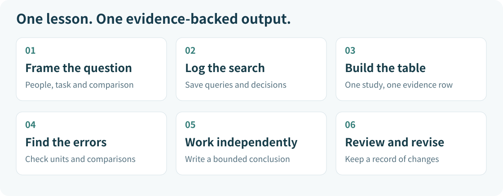

[中文](README.md) | [English](README.en.md)

# Lesson 2 · Turn a clinical question into research evidence

**About 55 minutes · No coding · A standalone sample lesson**



You are preparing a departmental presentation on this question: **Can large language models help clinicians improve diagnostic reasoning?** AI quickly produces a professional-looking summary. Your next task is to decide what you can use and what needs checking against the original papers.

Your output will be an evidence summary with traceable sources, clear comparisons and explicit limits.

## Know what you will be able to do

- Turn a broad question into one that can be searched and compared.
- Complete an evidence table for three studies and record how much you actually checked.
- Identify six kinds of error in an inaccurate summary.
- Write a conclusion that stays within the study design.

**Open these materials:** [source cards and public full-text links](sources.en.md), [evidence table CSV](../../templates/evidence-table.en.csv), and [search log CSV](../../templates/search-log.en.csv). If you have no AI account or cannot open the full text, use the routes in [Start here](../../START_HERE.en.md).

## Follow the 55-minute route

- **5 minutes:** understand the task and three essential distinctions.
- **8 minutes:** define the question and record a search.
- **12 minutes:** complete one evidence row with P1.
- **10 minutes:** check whether P2 and P3 answer the same question.
- **15 minutes:** complete the corrections and independent assignment.
- **5 minutes:** check the answers and revise.

Read the original sections identified on the source page during class. You are not expected to appraise all three full papers in 55 minutes; continue a full appraisal afterwards if needed.

## Task 1 · Separate three ideas

**Count the right unit.** The number of clinicians is not the number of cases. A clinician may answer several cases. Record clinicians, patients, cases and assessed responses separately. Whenever you see a number, ask what it counts.

**Identify who is using AI.** AI performing well on its own does not establish that clinicians perform better when they use it. One design compares a model with clinicians; another compares clinicians with and without AI assistance. Write down who is in each group and which resources they can use.

**Separate task performance from patient benefit.** Written cases, simulated consultations and real clinical encounters answer different questions. A better task score cannot automatically become a claim of fewer diagnostic errors, better patient outcomes or readiness for clinical deployment.

This lesson uses public research to discuss evidence. It does not address an individual patient's diagnosis or require any patient information.

### Keep these terms nearby

- **Differential diagnosis (DDx):** a list of possible diagnoses to compare.
- **OSCE / simulated consultation:** an assessment in a standardized scenario. OSCE stands for objective structured clinical examination.
- **Percentage points:** the result of subtracting two percentages. The difference between 76% and 74% is **2 percentage points**, not a relative increase of 2%.
- **Confidence interval:** retain the reported range when summarizing uncertainty. P1's interval crosses zero; its findings support neither a claim of superiority nor proof of equivalence.

## Task 2 · Write a task card

Replace “Is AI useful for clinicians?” with:

> In case-based assessment tasks, how does clinicians' diagnostic reasoning or differential diagnosis performance with large language model assistance compare with their performance using conventional resources?

The comparison concerns how clinicians work; the outcome concerns their performance on case tasks. Fill in the population, task, comparison, outcome and scope on the [task card](../../templates/task-card.en.md) before searching.

You can ask an AI tool:

```text
I am a clinician with no coding experience, preparing a research presentation.
Break the following question into: study population, task setting, intervention,
comparator, and outcomes to observe.

Question: In case-based assessment tasks, how does clinicians' diagnostic reasoning
or differential diagnosis performance with large language model assistance compare
with their performance using conventional resources?

Suggest a set of English search terms and identify concepts with possible synonyms.
At this step, do not provide papers, DOIs, or study findings. Do not turn the question
into diagnostic advice for an actual patient.
```

Check whether the tool replaced “scores on case tasks” with “diagnostic error rates in real patients.” If it did, restore the task card's original scope.

## Task 3 · Keep your own search record

Try this example query in PubMed:

```text
("large language model"[Title/Abstract] OR "generative AI"[Title/Abstract])
AND (physician*[Title/Abstract] OR clinician*[Title/Abstract])
AND ("diagnostic reasoning"[Title/Abstract] OR "differential diagnosis"[Title/Abstract])
```

After actually running it in [PubMed](https://pubmed.ncbi.nlm.nih.gov/), record today's date, the exact query, the actual result count and your selection reasons in the [search log](../../templates/search-log.en.csv). You can also search for an individual paper by its full title or DOI.

**Do not ask AI to supply a result count from memory.** If you did not run a search, leave the count blank and record **Not run**. Use a new row when you change the query or date filters.

For the remaining tasks, everyone uses P1, P2 and P3 from the source page so that answers can be compared. These are fixed teaching selections. The example query is not guaranteed to retrieve all three in one search, and this exercise is not a systematic review.

## Task 4 · Build one evidence row with P1

1. Open [P1 on the source page](sources.en.md#p1) and check its title, year, DOI and published version.
2. Use the indicated original sections to identify participants, groups, outcomes and main results.
3. Fill in the [evidence table](../../templates/evidence-table.en.csv). Include units beside numbers and distinguish percentages from percentage points.
4. Under **Source location**, name the section or table you actually read. Under **Verification status**, use **Relevant original sections checked**, **Abstract only**, or **Course card only; original text not yet checked**. Mark unread fields **To be checked**.

You can copy this prompt and add P1's course card or a short original passage you are permitted to use:

```text
Using only the material below, help me draft one evidence-table row.
Fields: Paper ID, Title, Year, DOI, Study setting, Participants and sample units,
Intervention and comparator, Outcome measures, Main results, Source location,
Limitations, Verification status.

Requirements:
1. Do not add papers, numbers, page numbers, or quotations from memory.
2. Separate clinician counts, case counts, and observation counts.
   Write "To be checked" for information absent from the supplied material.
3. Specify whether the comparison is clinicians with/without AI assistance,
   or the model alone versus clinicians.
4. Distinguish percentages from percentage points. Do not call a nonsignificant
   difference proof of equivalence.
5. Without patient outcome data, do not claim fewer diagnostic errors or clinical benefit.
6. Give only source locations actually supplied in the material.
   Otherwise write "Location not yet identified".
7. Initially set Verification status to "AI-organized; human verification pending".
   I will update it after reading the original paper.

Material:
[Paste P1's course card or a permitted short passage here.]
```

**What a useful row contains:** P1's participants field should identify the clinician count rather than relabel it as a patient count. Its results field should retain the score, between-group effect and uncertainty. Its source location should lead a reader back to the relevant original section. These are course-written examples of how to organize a row, not a record of a real model run.

Complete your own row before opening the [worked P1 CSV](../../examples/p1-worked.en.csv). Its columns match the blank table. Its teaching-example status does not replace your own original-source check.

A complete-looking AI table is not a reason to change **Human verification pending** to **Checked**. AI helps organize a first draft; your actual reading determines verification status.

## Task 5 · Decide whether P2 and P3 support the same conclusion

Use the same template for P2 and P3. Before writing “AI works” or “AI does not work,” ask of each study:

- Are the people and tools being compared the same?
- Is the input a written case or a simulated diagnostic dialogue?
- Is the outcome differential diagnosis performance, a reasoning score or a patient outcome?
- Does the study directly answer the task-card question, or provide related background?

Pay particular attention to P3. A comparison of a system with clinicians in simulated dialogue cannot directly establish whether clinicians improve when they use AI. Identifying a related paper as **Indirect/background evidence** is a useful result of evidence appraisal.

The three studies differ in task, comparison and outcomes. This lesson does not combine them into a single overall percentage improvement.

## Task 6 · Submit your work, then check the answers

Open [Practice and assignment](practice.en.md). Complete the six corrections, then independently finish a P3 evidence row and a conclusion of **150–200 English words**. This English assignment uses a word count; the Chinese version uses a separate Chinese-character count.

Submit:

1. Three evidence rows: P1 as the worked exercise, P2 for comparison, and P3 independently.
2. Six corrections labelled E1–E6, each with a reason and a source location.
3. A short conclusion explaining P3's relationship to the task question, its scope and the remaining evidence gaps.

Finally, use the [answers and scoring guide](answer-key.en.md) and [evidence checklist](../../templates/evidence-checklist.en.md) to revise. Scoring helps you spot omissions; it does not certify clinical competence.

## Take the method into your next literature task

Keep the task card, search log, evidence table and revision record. Every important number or conclusion you share with colleagues should be traceable to a source. Leave unverified information marked **To be checked** instead of filling gaps to make a table look complete.

[Start here](../../START_HERE.en.md) · [Course directory](../../course/README.en.md) · [Home](../../README.en.md)
