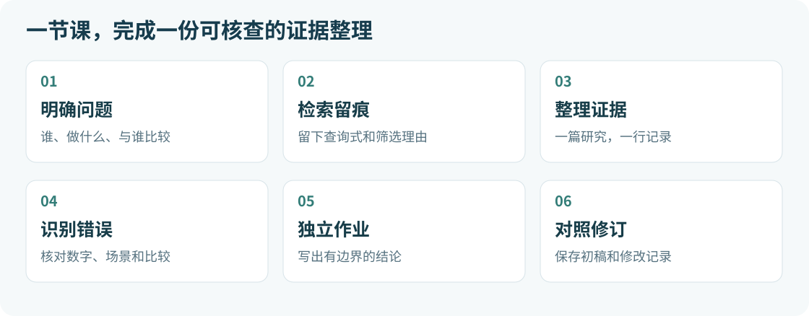

# 第 2 课｜从临床问题到文献证据

中文 · [English](README.en.md) · [课程地图](../../course/README.md) · [首页](../../README.md)

约 55 分钟 · 零编程 · 可独立学习

## 今天的任务：这份 AI 总结，能放进科室分享吗？

你想回答：“大模型能不能帮助医生提高诊断推理表现？”AI 很快给出一份看起来很专业的总结。先别复制到幻灯片：它数的是医生还是病例？比较的是医生加 AI，还是 AI 单独作答？

这节课就把这些判断练清楚，交出一份有来源、写清比较对象与适用范围的证据整理。



> 完成后，你手里有三样成果：三行证据表、E1–E6 六条纠错说明、P3 的 150–200 个汉字短结论。

[打开文献卡](sources.md) · [下载证据表](../../templates/evidence-table.csv) · [下载检索日志](../../templates/search-log.csv)

没有 AI 账号或原文打不开时，也能按[快速开始](../../START_HERE.md)的替代路径完成练习。课堂只用公开研究，无需患者资料。

## 55 分钟怎么用

1. 5 分钟：读懂任务与三个关键区别。
2. 8 分钟：写任务卡，留下检索记录。
3. 12 分钟：跟着 P1 填一行证据表。
4. 10 分钟：用 P2、P3 辨认场景与比较条件。
5. 15 分钟：六处纠错，独立完成 P3 作业。
6. 5 分钟：对照答案，保存修订稿。

按材料页指定的小节阅读即可，完整全文评读留到课后。

## 第一步｜遇到数字和结论，先问三句话

### “这个数字数的是什么？”

医生人数、患者人数、病例数与答题次数分别记录。同一名医生可能回答多个病例，50 名医生不能写成 50 个病例。

### “每一组是谁，能用什么？”

“AI 与医生谁答得好”比较模型与医生；“AI 能否帮到医生”比较医生有无 AI 辅助。这两种设计回答不同问题。

### “测到的是任务表现，还是患者获益？”

书面病例、模拟对话和实际门诊各有边界。任务评分提高，不能自动改写成误诊率下降、患者预后改善或已可临床部署。

### 三个读文献时会用到的词

- 鉴别诊断（DDx）：需要比较的候选诊断列表。
- OSCE／模拟对话：在标准化情境中进行的评测。
- 百分点：两个百分数直接相减。76% 与 74% 相差 2 个百分点，不等于相对提高 2%。

保留置信区间也是核查的一部分。P1 的差异区间跨过 0，不支持直接宣称优效，也不能证明两组等效。

## 第二步｜把宽问题变成一张任务卡

将“AI 对医生有没有用”收紧成：

> 临床医生在病例评测任务中使用大模型辅助，与常规资源相比，诊断推理或鉴别诊断表现怎样？

先填[任务说明卡](../../templates/task-card.md)里的对象、任务、比较、结果和适用范围。这里比较的是医生的工作方式，观察的是病例任务中的表现。

想用 AI 帮忙拆问题？复制这段：

```text
我是一名没有编程基础的临床医生，准备做一次文献分享。
请把这个问题拆成：研究对象、任务场景、干预、对照、需要观察的结果。
问题：临床医生在病例评测任务中使用大模型辅助，与常规资源相比，诊断推理或鉴别诊断表现怎样？
请给一组英文检索关键词，标出哪些概念可能有同义词。
本步骤不要提供论文、DOI或研究结果，不要把问题扩大成实际患者的诊断建议。
```

检查 AI 是否把“病例任务评分”换成了“真实患者误诊率”。如果换了，先修正任务卡。

## 第三步｜检索一次，就留一条真实记录

在 [PubMed](https://pubmed.ncbi.nlm.nih.gov/) 尝试：

```text
("large language model"[Title/Abstract] OR "generative AI"[Title/Abstract])
AND (physician*[Title/Abstract] OR clinician*[Title/Abstract])
AND ("diagnostic reasoning"[Title/Abstract] OR "differential diagnosis"[Title/Abstract])
```

把当天日期、原样检索式、实际命中数与筛选理由写入[检索日志](../../templates/search-log.csv)。更改检索式或日期筛选，就另记一行；找某篇论文时，也可检索完整题名或 DOI。

> 命中数来自实际运行。没运行就留空并写“未运行”，不让 AI 凭记忆补数。

本课接下来统一用 P1、P2、P3 方便对照。这是固定教学选文；示例检索不保证一次覆盖全部三篇，也不构成系统综述。

## 第四步｜跟着 P1，把第一行填实

1. 打开[P1 文献卡](sources.md#p1)，核对题名、年份、DOI 与正式发表版本。
2. 按卡片的原文位置查对象、分组、结局与主要结果。
3. 填入[证据表](../../templates/evidence-table.csv)，给数字带上单位，分开写百分数与百分点。
4. “来源位置”填实际看过的小节或表格；“核查状态”写实际阅读层级。没看到的字段留“待核查”。

可把 P1 课程卡片或允许使用的简短原文段落，连同这段提示词交给 AI：

```text
只根据我下面提供的材料，帮我整理一行证据表。
字段：文献ID、题名、年份、DOI、研究场景、对象与样本单位、干预与对照、
结局指标、主要结果、来源位置、局限、核查状态。

要求：
1. 不从记忆添加论文、数字、页码或原文引句。
2. 分开写医生人数、病例数与观察次数；材料未提供的项目写“待核查”。
3. 写清比较的是“医生有无AI辅助”，还是“模型单独与医生比较”。
4. 区分百分数与百分点；未显著差异不要写成等效。
5. 没有患者结局数据时，不生成误诊率下降或临床获益结论。
6. 来源位置仅写材料中实际提供的位置；没有就写“待定位”。
7. 核查状态先写“AI整理，人工待核”，由我阅读原文后修改。

材料：
【在这里粘贴 P1 的课程卡片或允许使用的短段落】
```

### 一行填好后，检查这三个格子

- 对象与样本单位：有没有写出医生人数，且没有改成患者人数？
- 主要结果：有没有保留评分、组间效应与不确定性？
- 来源位置：别人能否沿着这里回到对应原文小节？

自己填完，再打开[一行填写示范 CSV](../../examples/p1-worked.csv)对照。它与空白表列名一致，是课程示范，不是实际模型运行记录；示范状态也不代替你自己的核查记录。

核查状态由阅读决定：可写“已核对应原文小节”“仅核摘要”或“仅核课程卡片，原文待核”。AI 整理得完整，仍不等于人工已核。

## 第五步｜P2、P3 能接在同一个结论后面吗？

先用同一模板完成 P2 跟练，再辨认 P3 的设计。逐篇问：

- 比较的人或工具相同吗？
- 输入是书面病例，还是模拟诊断对话？
- 测的是鉴别诊断表现、推理评分，还是患者结局？
- 它直接回答任务卡的问题，还是提供相关背景？

P3 比较系统与医生在模拟对话中的表现，不能直接当作“医生使用 AI 后是否改善”的证据。把相关研究标成“间接／背景”，也是一个有价值的判断。P3 的完整证据行和短结论由你在下一步独立完成。

三篇的任务、比较方式与结局不同，不合并成一个“总体提升百分比”。

## 第六步｜先提交，再看答案

打开[练习与独立作业](practice.md)，交出：

1. 三行证据表：P1 跟练，P2 比较，P3 独立完成。
2. E1–E6 六条纠错：每条写改法、理由与来源位置。
3. P3 的 150–200 个汉字短结论：写清相关性、适用范围与证据缺口。

保存初稿后，用[答案与评分](answer-key.md)及[核查清单](../../templates/evidence-checklist.md)修订。评分帮助发现遗漏，不代表临床能力认证。

[现在去做练习 →](practice.md)

## 下次整理文献，直接复用这套材料

保留任务卡、检索日志、证据表与修订记录。分享给同事的重要数字与结论，都能找到来源；还没核到的内容继续标“待核查”。

[快速开始](../../START_HERE.md) · [文献材料](sources.md) · [课程地图](../../course/README.md) · [返回首页](../../README.md)
