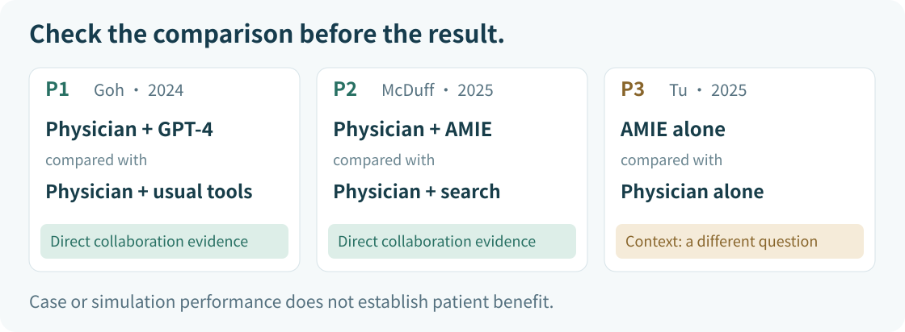

[中文](sources.md) | [English](sources.en.md)

# Source cards · Find the evidence behind each claim

**Source package checked: 2026-11-03.** These three publicly readable original studies are **fixed teaching selections**. They are not a systematic review, a complete search or all the latest evidence available on that date. Metadata was checked against the published journal versions; methods and results were checked against the full texts, rather than search snippets. The cards below are brief course-written paraphrases, not reproductions of the papers or figures.

**Our question:** In case-based assessment tasks, how does clinicians' diagnostic reasoning or differential diagnosis performance with large language model assistance compare with their performance using conventional resources?

P1 and P2 directly concern clinicians using AI. P3 helps you recognize a related but different question. Do not pool the three as if they evaluated the same intervention.

## P1 · Goh 2024: clinicians using GPT-4

**Published reference**

Goh E, Gallo R, Hom J, et al. **Large Language Model Influence on Diagnostic Reasoning: A Randomized Clinical Trial.** *JAMA Network Open*. 2024;7(10):e2440969. DOI: [10.1001/jamanetworkopen.2024.40969](https://doi.org/10.1001/jamanetworkopen.2024.40969). Published online on 2024-10-28. Use this journal version rather than an early preprint.

**Open the paper:** [PMC full text](https://pmc.ncbi.nlm.nih.gov/articles/PMC11519755/) · [PubMed metadata and abstract](https://pubmed.ncbi.nlm.nih.gov/39466245/).

- **Setting and units:** 50 physicians participated in a timed assessment using six written case vignettes. This was not a clinical trial enrolling 50 patients.
- **Comparison:** physicians with access to GPT-4 plus conventional resources versus physicians using conventional resources alone. This directly addresses our question. The model-alone analysis is separate.
- **Primary outcome:** median structured diagnostic reasoning scores were 76% versus 74%. The adjusted difference was **2 percentage points**, with a **95% CI of −4 to 8 percentage points; P = .60**. These scores are not patient-level diagnostic accuracy. A nonsignificant result does not establish equivalence or superiority.
- **Scope:** the study ran from 2023-11-29 to 2023-12-29 using ChatGPT Plus (GPT-4). The paper does not provide a fixed API checkpoint for exact reproduction. Few cases and varied use of the tool limit what can be inferred about benefits in real care.

**Go back to these original locations:**

- [Methods → Study Design](https://pmc.ncbi.nlm.nih.gov/articles/PMC11519755/#H2-3-ZOI241182): group allocation.
- [Study Outcomes](https://pmc.ncbi.nlm.nih.gov/articles/PMC11519755/#H2-5-ZOI241182): score definition.
- [Results → Primary Outcome: Diagnostic Performance](https://pmc.ncbi.nlm.nih.gov/articles/PMC11519755/#H2-7-ZOI241182) and [Table 2](https://pmc.ncbi.nlm.nih.gov/articles/PMC11519755/#zoi241182t2): numerical findings.
- [LLM Alone](https://pmc.ncbi.nlm.nih.gov/articles/PMC11519755/#H2-10-ZOI241182): the separate model-alone analysis. Do not substitute this result for the result of physicians using AI.

## P2 · McDuff 2025: AMIE as a differential diagnosis assistant

**Published reference**

McDuff D, Schaekermann M, Tu T, et al. **Towards accurate differential diagnosis with large language models.** *Nature*. 2025;642:451–457. DOI: [10.1038/s41586-025-08869-4](https://doi.org/10.1038/s41586-025-08869-4). Published online on 2025-04-09. Use this journal version rather than the 2023 preprint.

**Open the paper:** [PMC full text](https://pmc.ncbi.nlm.nih.gov/articles/PMC12158753/) · [Journal full text](https://www.nature.com/articles/s41586-025-08869-4) · [PubMed metadata and abstract](https://pubmed.ncbi.nlm.nih.gov/40205049/).

- **Setting and units:** 20 internists reviewed 302 published *NEJM* clinicopathological conference case reports. The number 302 counts case reports, not clinicians or prospectively enrolled patients.
- **Comparison:** two physicians reviewed each case under different assistance conditions. They first produced a differential diagnosis independently, then revised it using AMIE with optional conventional resources, or using only conventional resources such as search. This directly concerns our question. Model-alone performance was also studied separately.
- **Main finding:** differential diagnosis lists after AMIE assistance performed better than those after search assistance. Model-alone performance cannot stand in for the collaborative effect.
- **Scope:** the research version of AMIE was based on PaLM 2-L. The case reports span 2013–2023; 2025 is the publication year. Reviewing challenging published cases differs from routine clinical encounters and does not establish patient benefit.

**Go back to these original locations:**

- [Methods → Experimental design](https://pmc.ncbi.nlm.nih.gov/articles/PMC12158753/#Sec17): the sequence of tasks and allocation to conditions.
- [NEJM CPC case reports](https://pmc.ncbi.nlm.nih.gov/articles/PMC12158753/#Sec11): the source of the cases.
- [AMIE as a DDx assistant](https://pmc.ncbi.nlm.nih.gov/articles/PMC12158753/#Sec3) and [Fig. 2](https://pmc.ncbi.nlm.nih.gov/articles/PMC12158753/#Fig2): collaborative results and how they were assessed.
- [Limitations](https://pmc.ncbi.nlm.nih.gov/articles/PMC12158753/#Sec8): limits on generalization.

When copying a number, record the metric, assessment method and source location. Avoid mixing list-quality scores with accuracy measured by different assessment methods.

## P3 · Tu 2025: a comparison in simulated diagnostic dialogue

**Published reference**

Tu T, Schaekermann M, Palepu A, et al. **Towards conversational diagnostic artificial intelligence.** *Nature*. 2025;642:442–450. DOI: [10.1038/s41586-025-08866-7](https://doi.org/10.1038/s41586-025-08866-7). Published online on 2025-04-09. Use this published journal version.

**Open the paper:** [PMC full text](https://pmc.ncbi.nlm.nih.gov/articles/PMC12158756/) · [Journal full text](https://www.nature.com/articles/s41586-025-08866-7) · [PubMed metadata and abstract](https://pubmed.ncbi.nlm.nih.gov/40205050/).

- **Setting and units:** 20 primary care physicians and 20 patient actors participated in simulated text consultations. The published version reports **159 scenarios**, not 159 real patients. The Canada and India scenario set contains 145; another 14 scenarios came from the United Kingdom.
- **Comparison and relevance:** AMIE and physicians conducted separate consultations for the same simulated scenarios. This was not physicians plus AI versus conventional resources, so it cannot directly answer our collaboration question.
- **Main finding:** expert assessment found higher differential diagnosis accuracy for AMIE than for physicians. This concerns simulated dialogue performance, not patient outcomes.
- **Scope:** AMIE was a research system based on PaLM 2; the paper was published in 2025. Conclusions apply to the system and tasks studied. Synchronous text consultations differ from clinicians' routine workflows; these results do not establish replacement of physicians or benefits in real clinical care.

**Go back to these original locations:**

- [Methods → Remote OSCE study design](https://pmc.ncbi.nlm.nih.gov/articles/PMC12158756/#Sec34): all 159 scenarios, comprising 75 from India, 70 from Canada and 14 from the United Kingdom.
- [Online text-based consultation](https://pmc.ncbi.nlm.nih.gov/articles/PMC12158756/#Sec35): the two separate consultations.
- [Differential diagnosis accuracy](https://pmc.ncbi.nlm.nih.gov/articles/PMC12158756/#Sec2) and [Fig. 3](https://pmc.ncbi.nlm.nih.gov/articles/PMC12158756/#Fig3): the findings.

The supplementary set of 145 scenarios must not replace the total reported in the published version.

## Record what you actually checked

The studies use different models, tasks and outcome measures. Publication year is not the model-version date. A response from a current product with the same name cannot reproduce or refute a historical study by itself. These three papers do not form a clinical-use recommendation.

The source-package check used the PubMed metadata and full texts linked above. Some networks may encounter verification pages or redirects on PMC or journal sites; try another public entry point. Europe PMC also provides structured full texts: [P1](https://www.ebi.ac.uk/europepmc/webservices/rest/PMC11519755/fullTextXML), [P2](https://www.ebi.ac.uk/europepmc/webservices/rest/PMC12158753/fullTextXML), and [P3](https://www.ebi.ac.uk/europepmc/webservices/rest/PMC12158756/fullTextXML). These full texts were used to check the relevant methods and results for this package. You do not need to run code.

If you temporarily cannot access a paper, complete the paper-based exercise using the course cards. Record items you could not verify in your own log, use **Course card only; original text not yet checked**, and leave unread fields **To be checked**. The course's source check does not replace your own reading.

[Lesson](README.en.md) · [Practice](practice.en.md) · [Answers](answer-key.en.md)
