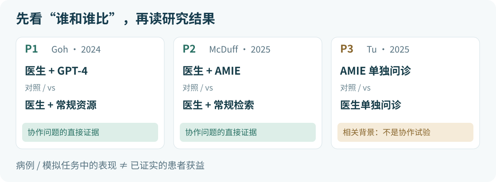

# 第 2 课｜文献卡与一手来源

中文 · [English](sources.en.md) · [返回课文](README.md) · [首页](../../README.md)

## 先看比较对象，再读结果

本课问题：临床医生在病例评测任务中使用大模型辅助，与常规资源相比，诊断推理或鉴别诊断表现怎样？

P1、P2 直接涉及医生使用 AI；P3 留给你识别一个相邻但不同的问题。先用下面的图认清研究设计，再按卡片里的链接回原文。

[读 P1](#p1) · [读 P2](#p2) · [读 P3](#p3) · [去做练习](practice.md)

来源核对日期：2026-11-03。三篇是固定教学选文，不是系统综述、完整检索或截至该日全部最新证据。元数据按正式期刊版、方法和结果按原文全文核对；以下为中文短转述，不复制论文全文或图表。

## P1｜Goh 2024：医生使用 GPT-4 的随机试验

> 阅读任务：找到“50”对应的单位，并把原始组评分、调整后差异与置信区间分开写。

### 认准这篇论文

Goh E, Gallo R, Hom J, et al. Large Language Model Influence on Diagnostic Reasoning: A Randomized Clinical Trial. *JAMA Network Open*. 2024;7(10):e2440969. DOI：[10.1001/jamanetworkopen.2024.40969](https://doi.org/10.1001/jamanetworkopen.2024.40969)。

正式期刊论文，在线发表于 2024-10-28；本课引用正式版，不使用早期预印本。

[PMC 全文](https://pmc.ncbi.nlm.nih.gov/articles/PMC11519755/) · [PubMed 元数据与摘要](https://pubmed.ncbi.nlm.nih.gov/39466245/)

### 四格学习卡

- 场景与单位：50 名医生参加限时书面病例评测，使用 6 个病例题；50 对应医生，不是患者。
- 比较：医生可用 GPT-4 加常规资源，对比医生仅用常规资源。直接回答本课问题；模型单独作答是另行分析。
- 主要结局：结构化诊断推理评分的中位数为 76% 对 74%；调整差值 2 个百分点，95% CI −4 至 8，P = .60。这不是患者诊断准确率；未检出显著差异不等于证明等效。
- 适用范围：研究在 2023-11-29 至 12-29 开展，使用 ChatGPT Plus（GPT-4）；原文未提供可固定复现的 API 检查点。病例少、使用方式不统一，不能直接推出真实诊疗收益。

### 回原文，按这个顺序核查

1. [Methods → Study Design](https://pmc.ncbi.nlm.nih.gov/articles/PMC11519755/#H2-3-ZOI241182)：核对分组。
2. [Study Outcomes](https://pmc.ncbi.nlm.nih.gov/articles/PMC11519755/#H2-5-ZOI241182)：核对评分定义。
3. [Results → Primary Outcome: Diagnostic Performance](https://pmc.ncbi.nlm.nih.gov/articles/PMC11519755/#H2-7-ZOI241182) 与 [Table 2](https://pmc.ncbi.nlm.nih.gov/articles/PMC11519755/#zoi241182t2)：核对数值。
4. [LLM Alone](https://pmc.ncbi.nlm.nih.gov/articles/PMC11519755/#H2-10-ZOI241182)：看清这是模型单独作答，不能替换医生使用 AI 的结果。

## P2｜McDuff 2025：AMIE 辅助鉴别诊断

> 阅读任务：顺着“先独立作答，再获得辅助”的流程，找出真正的人机协作比较。

### 认准这篇论文

McDuff D, Schaekermann M, Tu T, et al. Towards accurate differential diagnosis with large language models. *Nature*. 2025;642:451–457. DOI：[10.1038/s41586-025-08869-4](https://doi.org/10.1038/s41586-025-08869-4)。

正式期刊论文，在线发表于 2025-04-09；本课使用正式版，不使用 2023 年预印本。

[PMC 全文](https://pmc.ncbi.nlm.nih.gov/articles/PMC12158753/) · [期刊全文](https://www.nature.com/articles/s41586-025-08869-4) · [PubMed 元数据与摘要](https://pubmed.ncbi.nlm.nih.gov/40205049/)

### 四格学习卡

- 场景与单位：20 名内科医生评读 302 篇已发表的 NEJM 临床病理讨论病例。302 是病例报告数，不是医生数或前瞻性入组患者数。
- 比较：每个病例由两名医生分属不同辅助条件评读；先独立列鉴别诊断，再用 AMIE 加可选常规资源，或仅用搜索等常规资源修订。直接涉及本课问题；另有模型单独表现。
- 主要结果：AMIE 辅助后的鉴别诊断列表表现优于搜索辅助。读取协作结果时，不用模型单独表现替代。
- 适用范围：研究版 AMIE 基于 PaLM 2-L；病例报告覆盖 2013–2023 年，2025 年为发表年。挑战性病例评读不同于日常接诊，尚不能据此认定临床获益。

### 回原文，按这个顺序核查

1. [Methods → Experimental design](https://pmc.ncbi.nlm.nih.gov/articles/PMC12158753/#Sec17)：核对先后步骤与分配。
2. [NEJM CPC case reports](https://pmc.ncbi.nlm.nih.gov/articles/PMC12158753/#Sec11)：核对病例来源。
3. [AMIE as a DDx assistant](https://pmc.ncbi.nlm.nih.gov/articles/PMC12158753/#Sec3) 与 [Fig. 2](https://pmc.ncbi.nlm.nih.gov/articles/PMC12158753/#Fig2)：核对协作结果及评价方式。
4. [Limitations](https://pmc.ncbi.nlm.nih.gov/articles/PMC12158753/#Sec8)：核对外推边界。

抄录数字时，带上指标、评价方式和原文位置，分清列表质量分与不同评价方式下的准确率。

## P3｜Tu 2025：模拟诊断对话的比较

> 阅读任务：把“场景数”和“人数”各归其位，再判断它能否直接回答医生使用 AI 的问题。

### 认准这篇论文

Tu T, Schaekermann M, Palepu A, et al. Towards conversational diagnostic artificial intelligence. *Nature*. 2025;642:442–450. DOI：[10.1038/s41586-025-08866-7](https://doi.org/10.1038/s41586-025-08866-7)。

正式期刊论文，在线发表于 2025-04-09；本课使用正式版。

[PMC 全文](https://pmc.ncbi.nlm.nih.gov/articles/PMC12158756/) · [期刊全文](https://www.nature.com/articles/s41586-025-08866-7) · [PubMed 元数据与摘要](https://pubmed.ncbi.nlm.nih.gov/40205050/)

### 四格学习卡

- 场景与单位：20 名基层医生、20 名患者扮演者参与模拟文字问诊，正式版共 159 个场景；159 不是实际就诊患者人数。145 仅为加拿大与印度场景包，另有 14 个英国场景。
- 比较及相关性：AMIE 与医生分别问诊同一模拟场景，并非医生加 AI 对比常规资源，不能直接回答本课的协作问题。
- 主要结果：专家评价中 AMIE 的鉴别诊断准确性高于医生。这是模拟对话表现，不是患者结局。
- 适用范围：AMIE 是基于 PaLM 2 的研究系统，2025 年发表；结论适用于文中系统和任务。同步文字问诊与医生日常流程有差异，不能外推为替代医生或真实临床收益。

### 回原文，按这个顺序核查

1. [Methods → Remote OSCE study design](https://pmc.ncbi.nlm.nih.gov/articles/PMC12158756/#Sec34)：核对 159 个场景的来源——印度 75、加拿大 70、英国 14。
2. [Online text-based consultation](https://pmc.ncbi.nlm.nih.gov/articles/PMC12158756/#Sec35)：核对两次独立问诊。
3. [Differential diagnosis accuracy](https://pmc.ncbi.nlm.nih.gov/articles/PMC12158756/#Sec2) 与 [Fig. 3](https://pmc.ncbi.nlm.nih.gov/articles/PMC12158756/#Fig3)：核对结果。

补充材料中的 145 个场景包不可替代正式版总数。

## 把来源用到自己的表格里

三篇使用的模型、任务与指标不同；发表年份也不等于模型版本日期。今天同名产品的一次回答，不能用来复现或否定当时研究；这三篇也不构成临床应用推荐。

本次来源核对使用上述 PubMed 元数据与原文全文。PMC 或期刊链接若出现验证或跳转，换用另一公开入口。进一步核查可用 Europe PMC 的结构化全文接口：[P1 全文](https://www.ebi.ac.uk/europepmc/webservices/rest/PMC11519755/fullTextXML)、[P2 全文](https://www.ebi.ac.uk/europepmc/webservices/rest/PMC12158753/fullTextXML)、[P3 全文](https://www.ebi.ac.uk/europepmc/webservices/rest/PMC12158756/fullTextXML)；本次已据这些全文核对相关方法与结果。课堂无需运行代码。

原文暂时无法访问，就用卡片完成纸面练习，并记录无法复核的项目。你的核查状态写“仅核课程卡片，原文待核”，之后再补核。

[去填证据表 →](../../templates/evidence-table.csv) · [练习](practice.md) · [参考答案](answer-key.md) · [返回课文](README.md) · [返回首页](../../README.md)
